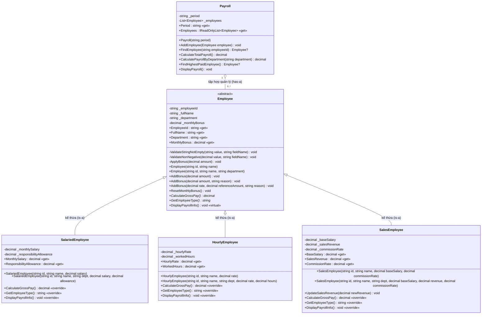

# TÀI LIỆU PHÂN TÍCH VÀ THIẾT KẾ KIẾN TRÚC HỆ THỐNG
## DỰ ÁN: HỆ THỐNG TÍNH LƯƠNG VÀ THƯỞNG NHÂN SỰ (OOP LAB W04 — C#)

---

## 1. SƠ ĐỒ LỚP (CLASS DIAGRAM)

Sơ đồ lớp chi tiết bằng Mermaid, thể hiện đầy đủ: phạm vi truy cập, thuộc tính, các constructor nạp chồng, ba phiên bản `AddBonus()`, các phương thức ghi đè (`override`), quan hệ tập hợp `Payroll 1 --> 0..* Employee`, và `Employee` là lớp trừu tượng (`abstract`).

---

## 2. CÁC QUYẾT ĐỊNH THIẾT KẾ VÀ GIẢI THÍCH

### 2.1. Lưu trữ thưởng: chỉ lưu tổng thưởng (`MonthlyBonus`)

- **Lựa chọn:** Lưu duy nhất một trường tổng tích lũy `_monthlyBonus` kiểu `decimal`, không lưu danh sách lịch sử từng khoản thưởng.
- **Giải thích:** Nghiệp vụ bài toán tập trung vào việc tính thu nhập gộp (`CalculateGrossPay()`) trong một kỳ lương và tái thiết lập bằng `ResetMonthlyBonus()` khi sang kỳ mới. Lưu tổng đơn giản hóa kiến trúc, tránh cấp phát bộ nhớ động không cần thiết, mà vẫn đảm bảo tính toàn vẹn nhờ việc cộng dồn qua hàm kiểm tra `ApplyBonus()`.
- Nếu tương lai cần truy vết chi tiết (audit log), ta chỉ cần bổ sung một `record BonusTransaction(decimal Amount, string Reason)` và sửa nội bộ lớp `Employee` mà không ảnh hưởng giao diện công khai hay các lớp dẫn xuất.

### 2.2. Kiểu tiền tệ: `decimal`

- **Lựa chọn:** Sử dụng `decimal` cho tất cả các trường liên quan đến tiền tệ (`MonthlySalary`, `ResponsibilityAllowance`, `HourlyRate`, `BaseSalary`, `SalesRevenue`, `MonthlyBonus`, giá trị trả về của `CalculateGrossPay()`), cũng như cho các tỷ lệ (`CommissionRate`, `rate` trong `AddBonus`), số giờ làm việc (`WorkedHours`).
- **Giải thích:** `decimal` là kiểu số thực 128-bit (28–29 chữ số có nghĩa) trong .NET được thiết kế chuyên cho phép toán tài chính. Khác với `double` (nhị phân IEEE 754), `decimal` lưu trữ ở cơ số 10 nên không gặp sai số làm tròn khi biểu diễn các giá trị tiền tệ phổ biến (ví dụ `0.1m`, `15000000m`). Trong bài lab, kết quả tính lương phải chính xác tuyệt đối (ví dụ `18.000.000` đúng đến từng đồng), nên `decimal` là lựa chọn bắt buộc.

### 2.3. Cơ chế Validation và Exception

- **Lựa chọn:** Sử dụng các exception chuẩn .NET:
  - `ArgumentNullException` — khi tham chiếu truyền vào là `null` (ví dụ `employee` trong `AddEmployee()`).
  - `ArgumentException` — khi chuỗi ký tự rỗng hoặc chỉ chứa khoảng trắng (`string.IsNullOrWhiteSpace()`).
  - `ArgumentOutOfRangeException` — khi giá trị số vượt ngoài phạm vi hợp lệ (lương âm, `WorkedHours` ngoài `[0, 250]`, `CommissionRate` ngoài `[0, 0.3]`, `rate` ngoài `(0, 0.5]`, `amount <= 0`, v.v.).
- **Tái sử dụng validation:** Gom logic kiểm tra chuỗi và số vào các phương thức `private static` của lớp `Employee` (như `ValidateStringNotEmpty()`, `ValidateNonNegative()`). Constructor ủy quyền (`: this(...)` và `: base(...)`) đảm bảo mã kiểm tra chỉ nằm ở một nơi duy nhất. Ngoại lệ được ném **trước** khi thay đổi trạng thái, đảm bảo tính nhất quán (Strong Exception Guarantee).

### 2.4. Cách `Payroll` lưu trữ danh sách nhân viên: `List<Employee>`

- **Lựa chọn:** Sử dụng `private readonly List<Employee> _employees` bên trong lớp `Payroll`. Phơi bày ra ngoài dưới dạng `IReadOnlyList<Employee>` để ngăn client sửa đổi danh sách.
- **Giải thích:** Trong C#, `class` là kiểu tham chiếu (reference type), nên `List<Employee>` thực chất giữ các tham chiếu (reference) đến các đối tượng trên managed heap. Điều này có nghĩa:
  - **Không xảy ra cắt lát đối tượng (object slicing)** — vấn đề chỉ tồn tại với kiểu giá trị trong C++ khi lưu theo giá trị. Trong C#, mọi đối tượng lớp con (`SalariedEmployee`, `HourlyEmployee`, `SalesEmployee`) được lưu qua tham chiếu kiểu cơ sở `Employee`, giữ nguyên kiểu thật (runtime type) và bảng phương thức ảo.
  - **Đa hình hoạt động chính xác** — khi gọi `employee.CalculateGrossPay()`, CLR sẽ dispatch đến phiên bản `override` của kiểu thật tại thời điểm chạy.
  - Không cần con trỏ thông minh (`unique_ptr`, `shared_ptr`) như C++ — bộ thu gom rác (Garbage Collector) của .NET tự quản lý vòng đời đối tượng.

---

## 3. TRẢ LỜI CÁC CÂU HỎI THIẾT KẾ NÂNG CAO (MỤC A.8)

### Câu 1: Vì sao `CalculateGrossPay()` phù hợp cho ghi đè, không phải nạp chồng?

`CalculateGrossPay()` đại diện cho cùng một hành vi nghiệp vụ — "tính tổng thu nhập gộp trong tháng" — nhưng công thức tính thay đổi hoàn toàn tùy theo loại hình nhân sự cụ thể tại thời điểm chạy (runtime). Ghi đè (`abstract`/`virtual` + `override`) cho phép lớp cơ sở `Employee` khai báo một giao diện đồng nhất không tham số, và CLR sẽ tự động dispatch đến đúng phiên bản của lớp con dựa trên kiểu thật của đối tượng (late binding). Nếu dùng nạp chồng (overloading), các phương thức phải khác nhau về danh sách tham số và trình biên dịch phải chọn cố định tại thời điểm biên dịch (compile-time), buộc lớp `Payroll` phải biết kiểu cụ thể của từng nhân viên, phá vỡ tính đa hình và nguyên lý Open/Closed.

### Câu 2: Vì sao `AddBonus()` phù hợp cho nạp chồng?

`AddBonus()` thể hiện cùng một thao tác nghiệp vụ — "ghi nhận tiền thưởng" — nhưng dữ liệu đầu vào khác nhau tùy tình huống thực tế: thưởng cố định `(decimal amount)`, thưởng cố định có lý do `(decimal amount, string reason)`, hoặc thưởng tính theo tỷ lệ `(decimal rate, decimal referenceAmount, string reason)`. Nạp chồng cho phép định nghĩa nhiều phương thức cùng tên trong cùng một lớp nhưng khác chữ ký (signature). Trình biên dịch C# sẽ quyết định (resolve) phiên bản nào được gọi hoàn toàn tại thời điểm biên dịch (compile-time / static dispatch) dựa trên kiểu và số lượng đối số, không phụ thuộc vào kiểu nhân sự lúc chạy.

### Câu 3: `Payroll` nên lưu đối tượng, tham chiếu hay con trỏ — và rủi ro cắt lát trong C#?

Trong C#, `class` là kiểu tham chiếu (reference type), nên `List<Employee>` tự động giữ tham chiếu đến các đối tượng trên managed heap — hành vi này tương đương với danh sách con trỏ lớp cơ sở trong C++. Nhờ vậy, không xảy ra hiện tượng cắt lát đối tượng (object slicing) vốn chỉ tồn tại ở C++ khi lưu đối tượng theo kiểu giá trị. Khi gọi `employee.CalculateGrossPay()`, CLR sẽ dispatch đến phiên bản `override` của kiểu thật tại runtime. Nếu thay vì kế thừa `class`, ta thiết kế `Employee` là `struct` (kiểu giá trị), thì sẽ không thể kế thừa (`struct` sealed ngầm định trong C#), mất hoàn toàn cơ chế đa hình thông qua `virtual`/`override`, và xảy ra boxing khi ép về kiểu `object` — do đó `struct` hoàn toàn không phù hợp cho bài toán này.

### Câu 4: Lớp cơ sở `Employee` nên là lớp cụ thể hay lớp trừu tượng?

`Employee` nên là `abstract class` vì trong nghiệp vụ thực tế không tồn tại nhân viên "chung chung" — mọi nhân viên đều thuộc một hình thức làm việc cụ thể với cách tính thu nhập riêng. Về mặt kỹ thuật, lớp `Employee` không thể đưa ra một công thức `CalculateGrossPay()` hay định nghĩa `GetEmployeeType()` mặc định nào có ý nghĩa. Khai báo `abstract` ngăn chặn hoàn toàn việc vô tình tạo thực thể `new Employee(...)` không hoàn chỉnh, đồng thời thiết lập một "hợp đồng" (contract) buộc mọi lớp dẫn xuất phải tự cài đặt đầy đủ các phương thức trừu tượng bằng từ khóa `override`.

### Câu 5: Nếu nhân viên kinh doanh cũng được trả theo giờ, kế thừa đơn có còn phù hợp?

Nếu `SalesEmployee` vừa hưởng hoa hồng doanh số vừa được trả lương theo giờ, kế thừa đơn từ `Employee` sẽ không thể tái sử dụng trực tiếp logic tính giờ đã có trong `HourlyEmployee`. C# không hỗ trợ đa kế thừa lớp (chỉ đa kế thừa interface), nên không thể kế thừa đồng thời `HourlyEmployee` và `SalesEmployee`. Giải pháp phù hợp là áp dụng nguyên lý "ưu tiên kết hợp hơn kế thừa" (Composition over Inheritance) hoặc mẫu Strategy Pattern: tách logic tính lương thành các thành phần (compensation component) độc lập, ví dụ interface `ICompensation` với các triển khai `HourlyCompensation`, `CommissionCompensation`, được gắn linh hoạt vào đối tượng nhân viên.

### Câu 6: Có nên đặt `CalculateTotalPayroll()` là static không?

Không nên. `CalculateTotalPayroll()` tính tổng chi phí lương dựa trên danh sách `_employees` thuộc về một đối tượng `Payroll` cụ thể (một kỳ lương, ví dụ `"2026-09"`). Phương thức `static` thuộc phạm vi toàn lớp và không có tham chiếu `this`, nên không thể truy cập trực tiếp vào trường thành viên `_employees` của từng thể hiện. Nếu cố tình dùng `static`, ta buộc phải truyền danh sách nhân viên vào qua tham số hoặc lưu ở biến `static` dùng chung, dẫn tới không thể quản lý đồng thời nhiều kỳ lương (ví dụ `"2026-09"` và `"2026-10"`) hay nhiều bảng lương chi nhánh độc lập — vi phạm tính đóng gói và nguyên lý trách nhiệm đơn (Single Responsibility).

---

## 4. CÁC ĐIỂM CẦN XÁC NHẬN TRƯỚC KHI CÀI ĐẶT (GIAI ĐOẠN 2)

1. **Kiểm tra chuỗi rỗng / khoảng trắng:** Dùng `string.IsNullOrWhiteSpace()`. Chuỗi `null`, `""`, hoặc `"   "` đều bị từ chối bằng `ArgumentException`.
2. **Kiểu exception cụ thể:** `ArgumentNullException` cho null, `ArgumentException` cho chuỗi rỗng/trắng, `ArgumentOutOfRangeException` cho số ngoài phạm vi hợp lệ.
3. **Quy tắc làm thêm giờ:** `WorkedHours <= 160`: `basePay = giờ * đơn giá`; `WorkedHours > 160`: `basePay = 160 * đơn giá + (giờ - 160) * đơn giá * 1.5m`. Không lưu thuộc tính riêng cho tiền làm thêm.
4. **Thưởng theo tỷ lệ:** `AddBonus(rate, referenceAmount, reason)` tính `bonusAmount = rate * referenceAmount`, sau đó cộng dồn vào `MonthlyBonus`.
5. **Trùng mã trong `Payroll`:** `AddEmployee()` ném `ArgumentException` khi mã nhân sự đã tồn tại, ném `ArgumentNullException` khi truyền `null`.
6. **Phiên bản .NET:** Sử dụng .NET 8 (hoặc phiên bản có sẵn trên máy), `<Nullable>enable</Nullable>`.
